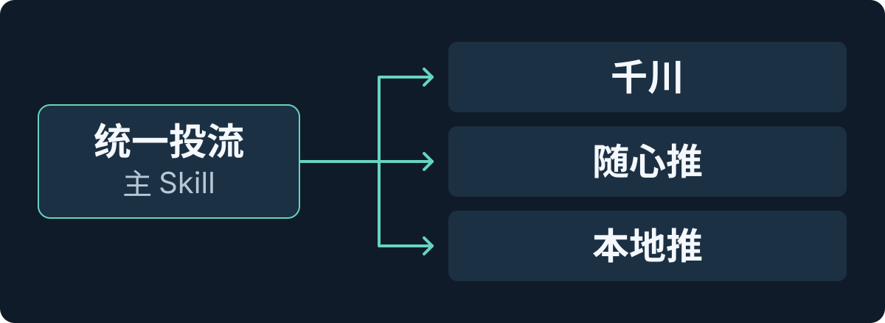

# ad-operator · 统一投流助手

**直接对话，查询和管理千川、随心推、巨量本地推。**

一个主 Skill，三个平台子 Skill，共用现有投流工作台后端。临时操作按需启动，完成后关闭，无需打开网页；只有明确开启连续监控或托管，才持续运行。

`Node.js ≥ 24` · `三个平台独立授权` · `本机保存配置与记录`

[支持范围](#支持范围) · [快速开始](#快速开始) · [运行方式](#运行方式) · [金额与接口边界](#金额与接口边界)

## 先看怎么用

在已安装 Skill、接好后端和平台授权的环境里，可以直接说：

> 列出我已授权的千川账户。
>
> 查询指定本地推账户的日预算，告诉我当前设置。
>
> 把指定千川全域计划的预算调整到我给定的金额，完成后回读结果。

Skill 根据本次真实返回定位账户和对象，执行用户已经明确授权的动作。需要改投放时，先读取当前配置，再提交与授权一致的参数，最后核对平台结果。上面的例子不会启动持续托管。

## 支持范围

三个平台分别识别账户、对象和指标。随心推使用自身应用授权，即使账户 ID 与千川相同，也不互认权限。

| 平台 | 可查询 | 已接入的修改动作 |
| --- | --- | --- |
| [千川](subskills/ad-operator-qianchuan/SKILL.md) | 授权账户、报表、全域/乘方计划、素材、余额与账户预算 | 对应计划的预算、ROI、启停；计划素材移除 |
| [随心推](subskills/ad-operator-suixin/SKILL.md) | 普通订单、商品全域订单与报表、趋势、建议和预估 | 终止指定普通订单 |
| [巨量本地推](subskills/ad-operator-local/SKILL.md) | 授权账户、标准项目/单元、素材、账户日预算、全域历史受众 | 账户日预算、标准项目预算、标准项目/单元启停 |

这是现有工作台的对话适配层，提供 Skill、运行控制和后端集成源代码。使用前需要已有的兼容后端及对应平台授权；仓库不包含完整网页工作台、个人后端或广告账户配置。

### 一个入口，三个子 Skill

<p align="center">
  
</p>

主 Skill 负责选平台、处理授权、启动和关闭进程；子 Skill 负责本平台的账户、对象和规则。三个子入口的平台参数固定，共用执行核心，不复制三套后台。

## 快速开始

需要 **Node.js 24 或更新版本**，以及已配置平台授权、具备本仓库集成接口的投流工作台后端。

### 1. 安装主 Skill 和三个子入口

以下使用默认的本地 Skill 目录。目标目录已有安装时，先保留现有配置和修改，不重复克隆覆盖。

```sh
git clone https://github.com/bigjun1-art/ad-operator.git ~/.codex/skills/ad-operator
cd ~/.codex/skills/ad-operator
node scripts/install-subskills.mjs
```

安装脚本为三个子 Skill 建立本地链接；已有同名、但指向其他内容的目录或链接时会停止，不覆盖原内容。

### 2. 指向现有后端

创建本机配置文件 `~/.config/ad-operator/config.json`：

```json
{
  "backendRoot": "/absolute/path/to/qianchuan-console"
}
```

将 `backendRoot` 换成兼容后端的实际绝对路径。新环境还需完成[后端接入](integration/backend-patch.md)，复制适配文件并接好所列接口和请求校验；只克隆本仓库不足以直接操作广告平台。配置位置、运行记录目录和完整依赖见[本地配置](references/backend.md)。

### 3. 检查环境，再查真实账户

以下命令均在主 Skill 目录运行：

```sh
node scripts/ad.mjs doctor
node scripts/ad.mjs actions qianchuan
node scripts/ad.mjs read accounts.list --platform qianchuan
```

`doctor` 检查本地配置和所需文件；真实账户查询才会核实本次应用授权。查询随心推或本地推时，将平台改为 `suixin` 或 `local`。命令执行后关闭本次临时后台，不打开网页。

需要了解某个动作的字段时，读取当前定义：

```sh
node scripts/ad.mjs describe plan.budget.set --platform qianchuan
node scripts/ad.mjs describe order.terminate --platform suixin
node scripts/ad.mjs describe account.budget.set --platform local
```

参数和授权结构见[主 Skill](SKILL.md)；实际动作以 `actions`、`describe` 的输出为准。

## 运行方式

| 方式 | 实际行为 | 何时结束 |
| --- | --- | --- |
| 单次查询 `read` | 读取平台真实账户、报表或配置 | 查询完成后关闭 |
| 单次修改 `prepare → execute` | 先读原值，再执行用户明确授权的变更并核对结果；`prepare` 本身不提交 | 本次操作完成后关闭 |
| 半自动 `recommend` | 持续监控并形成具体建议，由用户授权后通过普通执行入口提交 | 叫停、到期或规则完成后退出 |
| 全自动 `managed` | 在明确授权的账户、对象、动作、金额边界和期限内执行固定规则 | 叫停、到期、规则完成或需核实结果时退出 |

连续运行必须由用户明确开启。单次查询或单次调预算不会启动托管，也不会恢复旧策略。托管范围、规则、停止和结果核实方式见[持续运行](references/managed.md)。

平台只返回受理回执时，结果保持“已受理”；结果不明时先查询核实，不自动重发。**停止托管只停止本技能的进程，广告本身不会因此暂停。** 暂停广告需要用户对具体对象的明确指令。

## 金额与接口边界

- **千川：**官方 ROI 与实付金额除以消耗的计算值分别保留。`dim=all` 是整体但不含标准，不能作为所有业务的账户总额；元、分、千分之一分按后端已核实的对应接口单位处理。
- **随心推：**普通订单和商品全域订单分开。终止普通订单不是暂停，也没有恢复动作；当前未封装创建订单、修改预算或 ROI。普通报表的金额单位尚未取得直接明确的官方依据，查询保留原值和 `unitKnown:false`，不作为元金额触发托管。仅按订单数终止的规则须有明确授权，且用户未要求金额边界；不能删掉用户已给的金额条件来启动托管。
- **本地推：**账户日预算按元、最多两位小数处理；标准项目配置保留分原值并另给元值。账户日预算、项目预算和全域整场预算是不同对象，隔日预算受理也不等于已经生效。本项目尚未核实本地推全域对象预算、目标 ROI、素材生命周期的专用 MAPI 写入，以及全域启停与标准对象的对应关系，当前不提供这些全域修改动作。全域受众用于 T-1 及以前的历史分析，不作为实时账户主报表。

数据缺失、范围不完整或金额单位未知时，保留错误或未知状态，不补零，不用模拟数据冒充平台结果。正式操作仍需具备该账户的应用授权和接口权限。

## 配置与数据留在本机

仓库仅发布技能说明和通用代码。广告账户 ID、凭据、真实报表、操作回执、托管政策和个人电脑路径均不随仓库分发。

平台凭据由现有后端管理；本机配置默认位于 `~/.config/ad-operator/config.json`，运行状态默认位于 `~/.local/state/ad-operator`。这些内容放在技能目录之外，不提交到 GitHub。

## 验证与目录

```sh
npm test
```

仓库测试覆盖三个固定平台入口、隔离安装、托管授权、到期退出和未知结果不重提等行为。自动化测试使用隔离驱动和临时目录，不向真实广告账户提交变更；HTTP 接口与完整后端生命周期测试在现有后端项目中运行。

| 路径 | 用途 |
| --- | --- |
| [SKILL.md](SKILL.md) | 主入口的动作选择、授权和运行规则 |
| [subskills/](subskills/) | 千川、随心推、本地推三个子 Skill |
| [scripts/](scripts/) | 统一命令、子入口安装和托管运行控制 |
| [integration/](integration/) | 现有后端的适配源代码及接入说明 |
| [references/](references/) | 本地配置、平台边界和持续运行说明 |
