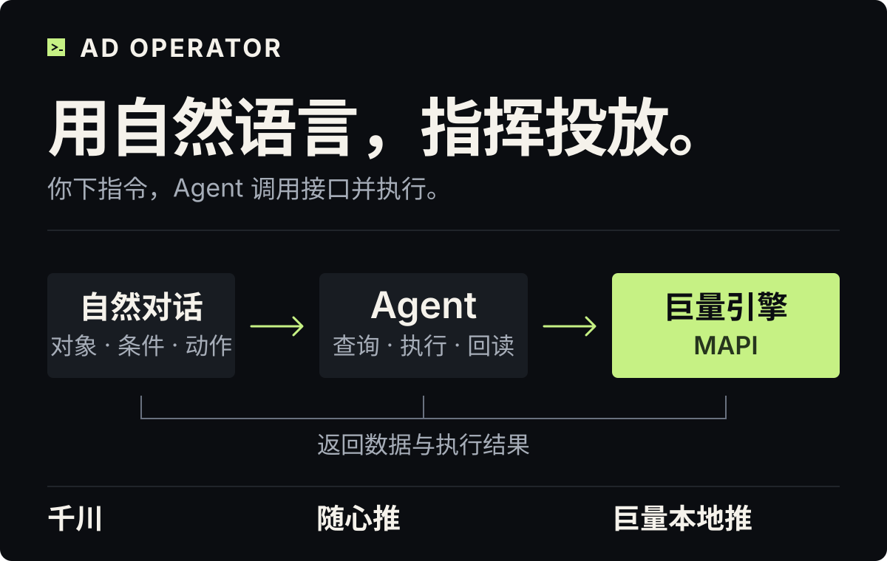

# ad-operator

<p align="center">
  
</p>

<p align="center">
  <a href="#快速开始">快速开始</a> ·
  <a href="#用对话组织投放">对话操作</a> ·
  <a href="#按分钟跟踪按素材分析">分钟盯盘与素材分析</a> ·
  <a href="#三个平台一套对话入口">平台能力</a>
</p>

**你的投放指令，由 Agent 执行。**

ad-operator 将千川、随心推和巨量本地推工作台接入自然对话。你指定账户、投放对象、处理条件与允许动作，Agent 通过巨量引擎 MAPI（营销开放接口）读取数据，提出建议或执行授权操作，再查询平台结果。

你可以在一次对话里选户、查报表、查看计划素材、调整预算与目标 ROI、管理启停；也可以设定查询频率和结束时间，让 Agent 持续跟踪投放。日常查询与单次调整按需启动、完成后关闭，连续盯盘和托管按你设定的期限运行，无需常开网页。

## 用对话组织投放

完成安装和平台授权后，可以这样下达指令：

> 列出我已授权的千川账户。
>
> 查询这个本地推账户的日预算，告诉我当前金额和生效方式。
>
> 列出这个千川计划里的素材名称、ID 和状态。
>
> 把这个千川全域计划的预算调整到我指定的金额，完成后查询实际配置。

持续盯盘时，一次说明账户、报表范围、频率、处理条件和结束时间。例如：

> 监控这个千川账户的视频投放，每分钟查询一次整体报表，持续到今晚十点。达到我设定的条件时给出建议，由我决定是否执行。

单次修改时，Agent 先读取当前配置，再提交你指定的目标值，随后查询平台结果。持续运行提供两种模式：

| 模式 | 如何处理投放 |
| --- | --- |
| 半自动建议 `recommend` | 定时取数，条件命中后保存具体建议；你授权执行后，再提交对应操作。 |
| 全自动托管 `managed` | 按你事先确定的规则，自动执行指定账户、对象和动作范围内的操作，并遵守金额、动作次数和截止时间限制。 |

每条规则在一次托管中最多触发一次。规则全部完成、授权到期或你叫停时，进程退出。收到无法确认结果的回执时，托管停止后续操作，保留记录供查询核对。

停止托管会关闭监控和执行进程。若要同时暂停广告，需要在指令中指定要暂停的计划、项目或单元。托管规则与管理命令见[持续运行说明](references/managed.md)。

## 按分钟跟踪，按素材分析

投放中的决策需要连续的数据：这一轮花了多少、订单如何变化、哪些素材值得继续观察。工作台将定时查询、素材表现和投放操作放在同一套流程中，由你设定处理条件，Agent 负责取数、分析和执行。

对话 Skill 支持定时查询和投放操作；所接工作台后端还提供千川直播素材监控。

- **定时查询投放表现。** 对话监控支持 15～3600 秒的查询间隔，例如每 60 秒读取一次所选账户、报表类型和场景的汇总。每轮取得平台当时返回的消耗、订单和 ROI，按你设定的条件形成建议或执行投放调整。
- **记录素材表现。** 工作台后端的千川直播监控可定期保存关联计划下各视频素材的累计消耗、点击率、支付 ROI、审核状态和追投状态，并按素材筛选条件给出观察建议。直播分钟流速取自绑定主播的汇总数据。
- **通过对话操作投放。** 当前入口支持账户和报表查询、计划或项目配置调整，以及千川计划素材清单查询与移除。素材清单提供名称、ID 和状态。

监控设置中的“每分钟”指每隔 60 秒查询一次。现有对话托管使用所选账户、报表类型和场景的汇总数据；后端素材监控保存每轮取得的累计指标。单素材相邻快照的差值计算、连续触发规则和自动追投对话功能仍待接入。

## 三个平台，一套对话入口

| 平台 | 查询功能 | 投放操作 |
| --- | --- | --- |
| [千川](subskills/ad-operator-qianchuan/SKILL.md) | 授权账户、报表、全域/乘方计划、计划素材清单、余额和账户预算 | 对应计划的预算、目标 ROI、启停；移除计划中的指定素材 |
| [随心推](subskills/ad-operator-suixin/SKILL.md) | 普通订单、商品全域订单与报表、趋势、建议和预估 | 终止指定普通订单 |
| [巨量本地推](subskills/ad-operator-local/SKILL.md) | 授权账户、标准项目和单元、素材、账户日预算、全域历史受众 | 账户日预算、标准项目预算、标准项目和单元启停 |

随心推的终止操作会结束普通订单，当前没有对应的恢复动作。创建订单、修改随心推预算与 ROI 尚未接入。

本地推全域的对象预算、目标 ROI、素材创建、修改、暂停和关闭尚未接入；当前启停操作用于标准项目和单元。全域受众查询提供前一天及更早日期的受众分布，可按直播、门店和受众维度筛选。

### 一个主 Skill，三个平台入口

主 Skill 根据业务选择平台；三个子 Skill 分别处理本平台的账户授权、投放对象和接口参数，共用查询与执行程序。随心推使用自身应用授权，与千川 PC 应用分别取得账户列表。

### 报表与金额

- **千川余额：**`account_general_total` 原值的单位为千分之一分，除以 100000 得到元。查询同时保留原值和元值。
- **千川报表：**`dim=all` 统计标准以外的整体投放，标准投放通过 `dim=standard` 单独查询。官方支付 ROI、净成交 ROI 和“实付金额 ÷ 消耗”的计算值分别展示。
- **本地推预算：**账户日预算以元设置，最多两位小数；标准项目详情中的预算和出价原值为分，查询另给元值，修改预算时输入元。隔日预算受理后，按回执中的生效日期查询结果。
- **随心推普通报表：**金额字段保留接口原值，附 `unitKnown:false`。当前托管支持在用户未设置金额条件时，按订单数触发普通订单终止；带金额条件的规则暂不可运行。

## 快速开始

运行环境需要 **Node.js 24 或更新版本**，以及已完成平台授权的兼容投流工作台后端。本仓库提供 Skill 和后端适配源代码；完整工作台后端需另行部署。

### 1. 安装 Skill

在默认本地 Skill 目录安装：

```sh
git clone https://github.com/bigjun1-art/ad-operator.git ~/.codex/skills/ad-operator
cd ~/.codex/skills/ad-operator
node scripts/install-subskills.mjs
```

已有安装时从原目录更新，并保留本地修改。安装脚本为三个子 Skill 建立链接；遇到指向其他内容的同名目录或链接时会停止。

### 2. 配置后端路径

创建 `~/.config/ad-operator/config.json`，将 `backendRoot` 替换为本机后端的实际绝对路径：

```json
{
  "backendRoot": "/absolute/path/to/qianchuan-console"
}
```

首次接入后端时，按[后端接入说明](integration/backend-patch.md)安装适配文件、配置所需路由和请求校验。平台凭据由原后端管理。本机配置保存后端路径，运行状态默认保存在 `~/.local/state/ad-operator`；账户数据、操作回执和托管规则保存在本机，发布仓库时排除这些文件。

### 3. 查询账户

在主 Skill 目录运行：

```sh
node scripts/ad.mjs doctor
node scripts/ad.mjs actions qianchuan
node scripts/ad.mjs read accounts.list --platform qianchuan
```

`doctor` 检查配置和后端文件，`actions` 列出操作，`read accounts.list` 查询该应用授权的账户。随心推的平台参数为 `suixin`，本地推为 `local`。

查询具体操作所需的参数：

```sh
node scripts/ad.mjs describe plan.budget.set --platform qianchuan
node scripts/ad.mjs describe order.terminate --platform suixin
node scripts/ad.mjs describe account.budget.set --platform local
```

参数结构、执行授权和返回结果见[主 Skill 说明](SKILL.md)。

## 开发资料

- [scripts/](scripts/)：命令入口、子 Skill 安装和托管运行程序。
- [integration/](integration/)：现有后端的适配代码与接入说明。
- [references/backend.md](references/backend.md)：本地配置、运行状态目录与后端依赖。
- [references/managed.md](references/managed.md)：托管规则、指标、停止和结果核对。

运行测试：

```sh
npm test
```

测试通过隔离驱动和临时目录验证平台入口、安装、授权与进程退出。后端 HTTP 和完整运行流程的测试在工作台后端项目中执行。
